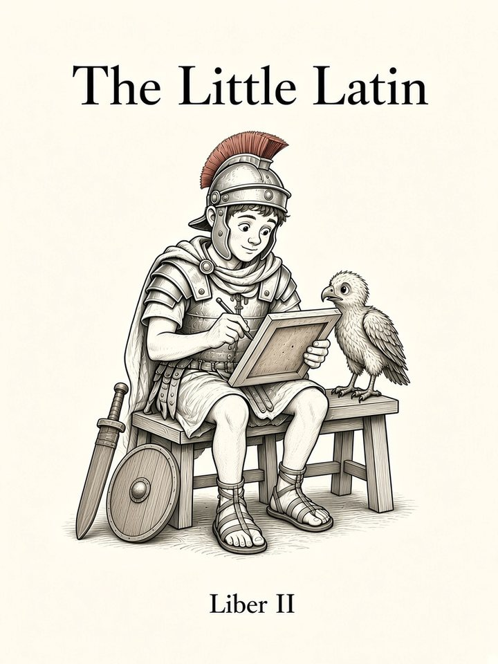

# Liber II: Rēs Cotīdiānae

<figure class="book-cover" markdown="1">
{ width="360" height="480" }
</figure>

*Daily Things: More nouns, past and future*

!!! info "Coming soon"
    This book hasn't been written yet. Below is the planned sequence of chapters, which may change as the course grows.

Chapter numbers continue across books. **G** = grammar · **V** = vocabulary · **S** = speaking goal.

| # | Chapter | Contents | Status |
|---|---|---|---|
| 13 | [**Rēx et Mīles**](01-rex-et-miles.md) | G: 3rd decl consonant stems m/f. V: people/roles. | ✅ available |
| 14 | [**Corpus et Nōmen**](02-corpus-et-nomen.md) | G: 3rd decl neuters. V: body. | ✅ available |
| 15 | [**Ovēs et Mare**](03-oves-et-mare.md) | G: 3rd decl i-stems. V: animals, nature. | ✅ available |
| 16 | [**Heri et Crās**](04-heri-et-cras.md) | G: imperfect & future active (1st/2nd conj), erat/erit. V: time words. S: what you were doing / will do. | ✅ available |
| 17 | [**Legam, Audiam**](05-legam-audiam.md) | G: future/imperfect of 3rd/4th/io; future in -am/-ēs vs -bō. S: plans. | ✅ available |
| 18 | [**Possum!**](06-possum.md) | G: possum, complementary infinitive, volō/nōlō present. V: abilities, wants. S: I can / want / don't want. | ✅ available |
| 19 | [**Hic et Ille**](07-hic-et-ille.md) | G: hic, ille, iste, is, īdem. S: this one, that one (shopping). | ✅ available |
| 20 | **Fortis et Celer** | G: 3rd decl adjectives; adjective agreement across declensions (bonus rēx, fēmina fortis). S: describe people. | coming |
| 21 | **Sē et Suum** | G: full declension of ego/tū/nōs/vōs (mē, tē, nōbīs, vōbīs, meī/nostrum…); reflexive sē/suus vs eius; ipse. S: "he washes himself" / "his own". | coming |
| 22 | **Ūnus, Duo, Trēs** | G: numerals, partitive genitive, ablative of time. V: money, time, calendar. S: telling time, prices (quantī?). | coming |
| 23 | **Manus et Diēs** | G: 4th & 5th decl; all five declensions summarized. V: days, things (rēs!). | coming |
| 24 | **Recapitulātiō II** | Review + longer story. | coming |
