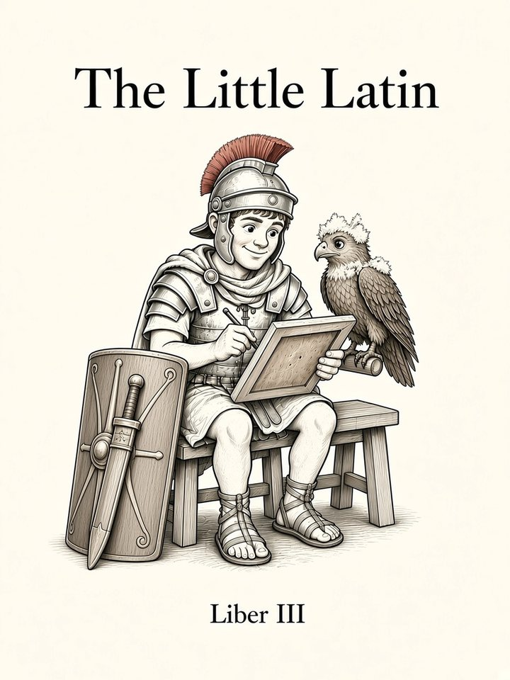

# Liber III: Fābulae

<figure class="book-cover" markdown="1">
{ width="360" height="480" }
</figure>

*Stories: Narrating the past, relatives, passive*

!!! info "Coming soon"
    This book hasn't been written yet. Below is the planned sequence of chapters, which may change as the course grows.

Chapter numbers continue across books. **G** = grammar · **V** = vocabulary · **S** = speaking goal.

| # | Chapter | Contents | Status |
|---|---|---|---|
| 25 | **Vēnī, Vīdī, Vīcī** | G: principal parts; perfect active (all conj.). S: what did you do? | coming |
| 26 | **Erat et Fuit** | G: perfect vs imperfect aspect; narration. S: tell a story. | coming |
| 27 | **Iam Fēceram** | G: pluperfect & future perfect. S: sequencing events. | coming |
| 28 | **Quī, Quae, Quod** | G: relative pronoun, relative clauses. S: the man who… | coming |
| 29 | **Quis Venit?** | G: interrogative pronoun vs adjective; indefinites aliquis, quīdam, quisque. | coming |
| 30 | **Amor, Amāris** | G: present-system passive (all conj.); ablative of agent vs means. | coming |
| 31 | **Amātus Est** | G: perfect passive system (needs 4th principal part). | coming |
| 32 | **Ferō, Eō, Fīō** | G: irregulars ferō, eō (+compounds), fīō; full volō/nōlō/mālō. | coming |
| 33 | **Melior et Optimus** | G: comparison of adjectives (regular, irregular), quam vs abl. of comparison. | coming |
| 34 | **Celeriter!** | G: adverbs, formation and comparison. S: how/how fast/better. | coming |
| 35 | **Ablātīvus** | G: ablative uses summary (manner, accompaniment, cause, degree of difference, respect, description). | coming |
| 36 | **Recapitulātiō III** | Adapted myth (e.g., Daedalus). | coming |
