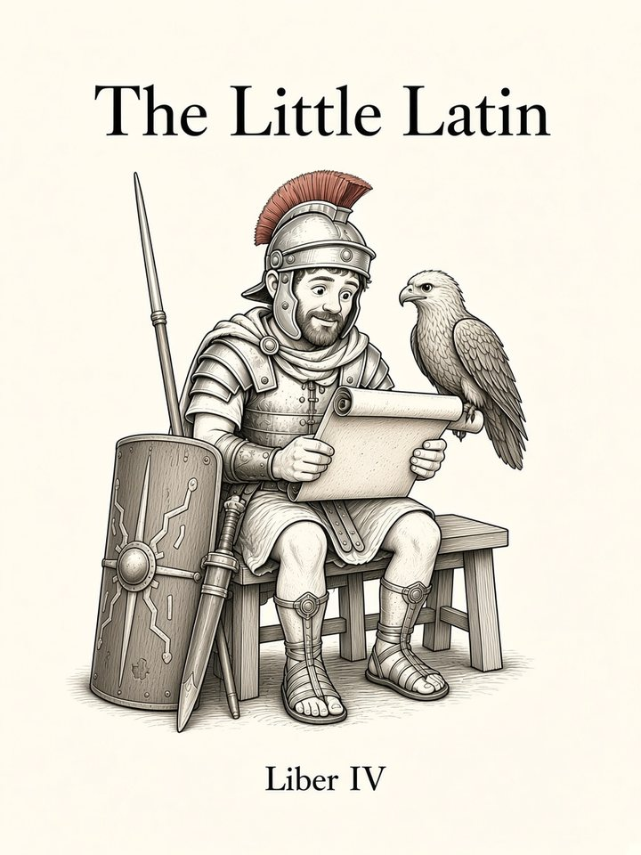

# Liber IV: Verba Agentia

<figure class="book-cover" markdown="1">
{ width="360" height="480" }
</figure>

*Verbals: Participles and infinitives*

!!! info "Coming soon"
    This book hasn't been written yet. Below is the planned sequence of chapters, which may change as the course grows.

Chapter numbers continue across books. **G** = grammar · **V** = vocabulary · **S** = speaking goal.

| # | Chapter | Contents | Status |
|---|---|---|---|
| 37 | **Laudātus** | G: perfect passive participle as adjective & clause. | coming |
| 38 | **Laudāns** | G: present active participle (3rd decl adj declension). | coming |
| 39 | **Laudātūrus** | G: future active participle; active periphrastic. S: I am about to… | coming |
| 40 | **Urbe Captā** | G: ablative absolute. | coming |
| 41 | **Sex Īnfīnītīvī** | G: all six infinitives (pres/perf/fut × act/pass). | coming |
| 42 | **Dīcit Sē Venīre** | G: indirect statement, acc. + inf., tense relations, sē. S: report what someone said; putō + inf. opinions. | coming |
| 43 | **Loquor** | G: deponent & semi-deponent verbs; their participles & imperatives; ablative with ūtor etc. | coming |
| 44 | **Mihi Placet** | G: dative with special verbs, compounds, adjectives; impersonals (licet, placet, oportet); dative of reference/purpose. | coming |
| 45 | **Domī Mīlitiaeque** | G: place & time constructions consolidated; locative; extent of time/space. | coming |
| 46 | **Meminī, Ōdī, Coepī** | G: defective verbs; inquit; genitive with verbs & adjectives. | coming |
| 47 | **Nōlī Timēre** | G: negative commands fully; future imperative; prohibition styles. | coming |
| 48 | **Recapitulātiō IV** | Adapted Roman history narrative. | coming |
