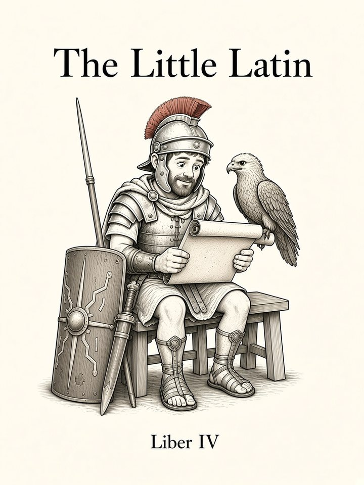

# Liber IV: Verba Agentia

<figure class="book-cover" markdown="1">
{ width="360" height="480" }
</figure>

*Verbals: Participles and infinitives*

!!! tip "In progress"
    Chapters are arriving one by one. Below is the planned sequence, which may change as the course grows.

Chapter numbers continue across books. **G** = grammar · **V** = vocabulary · **S** = speaking goal.

| # | Chapter | Contents | Status |
|---|---|---|---|
| 37 | [**Laudātus**](01-laudatus.md) | G: perfect passive participle as adjective & clause. | ✅ available |
| 38 | [**Laudāns**](02-laudans.md) | G: present active participle (3rd decl adj declension). | ✅ available |
| 39 | [**Laudātūrus**](03-laudaturus.md) | G: future active participle; active periphrastic. S: I am about to… | ✅ available |
| 40 | [**Urbe Captā**](04-urbe-capta.md) | G: ablative absolute. | ✅ available |
| 41 | [**Sex Īnfīnītīvī**](05-sex-infinitivi.md) | G: all six infinitives (pres/perf/fut × act/pass). | ✅ available |
| 42 | [**Dīcit Sē Venīre**](06-dicit-se-venire.md) | G: indirect statement, acc. + inf., tense relations, sē. S: report what someone said; putō + inf. opinions. | ✅ available |
| 43 | [**Loquor**](07-loquor.md) | G: deponent & semi-deponent verbs; their participles & imperatives; ablative with ūtor etc. | ✅ available |
| 44 | [**Mihi Placet**](08-mihi-placet.md) | G: dative with special verbs, compounds, adjectives; impersonals (licet, placet, oportet); dative of reference/purpose. | ✅ available |
| 45 | [**Domī Mīlitiaeque**](09-domi-militiaeque.md) | G: place & time constructions consolidated; locative; extent of time/space. | ✅ available |
| 46 | [**Meminī, Ōdī, Coepī**](10-memini-odi-coepi.md) | G: defective verbs; inquit; genitive with verbs & adjectives. | ✅ available |
| 47 | [**Nōlī Timēre**](11-noli-timere.md) | G: negative commands fully; future imperative; prohibition styles. | ✅ available |
| 48 | **Recapitulātiō IV** | Adapted Roman history narrative. | coming |
