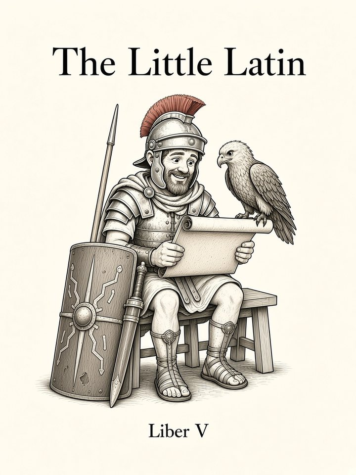

# Liber V: Modus Subiūnctīvus

<figure class="book-cover" markdown="1">
{ width="360" height="480" }
</figure>

*The Subjunctive: Wishes, purposes, reported thought*

!!! tip "In progress"
    Chapters are arriving one by one. Below is the planned sequence, which may change as the course grows.

Chapter numbers continue across books. **G** = grammar · **V** = vocabulary · **S** = speaking goal.

| # | Chapter | Contents | Status |
|---|---|---|---|
| 49 | [**Eāmus!**](01-eamus.md) | G: present subjunctive forms; hortatory/jussive/deliberative. S: let's… | ✅ available |
| 50 | [**Utinam!**](02-utinam.md) | G: optative; potential; velim/vellem. S: polite requests, wishes. (*vellem* taught as a chunk here; its imperfect-subjunctive form is analyzed in Ch52.) | ✅ available |
| 51 | [**Ut Discam**](03-ut-discam.md) | G: purpose clauses (ut/nē, relative purpose). | ✅ available |
| 52 | [**Tam Fessus Ut…**](04-tam-fessus-ut.md) | G: imperfect subjunctive; result clauses. | ✅ available |
| 53 | [**Rogō Quid Faciās**](05-rogo-quid-facias.md) | G: perfect/pluperfect subjunctive; indirect questions. | ✅ available |
| 54 | [**Ōrdō Temporum**](06-ordo-temporum.md) | G: sequence of tenses. | ✅ available |
| 55 | [**Cum Vēnisset**](07-cum-venisset.md) | G: cum clauses (temporal, circumstantial, causal, concessive). | ✅ available |
| 56 | **Imperat Ut** | G: indirect commands; verbs of asking/ordering/persuading. | coming |
| 57 | **Sī…** | G: conditionals (simple, future more/less vivid, contrary-to-fact). S: what would you do if… | coming |
| 58 | **Timeō Nē** | G: fear clauses; quīn, quōminus; doubting/prevention. | coming |
| 59 | **Dum, Antequam, Dummodo** | G: temporal clauses with ind./subj.; proviso; concessive (quamquam/quamvīs); relative clause of characteristic. | coming |
| 60 | **Recapitulātiō V** | Adapted Cicero letter / Nepos life. | coming |
