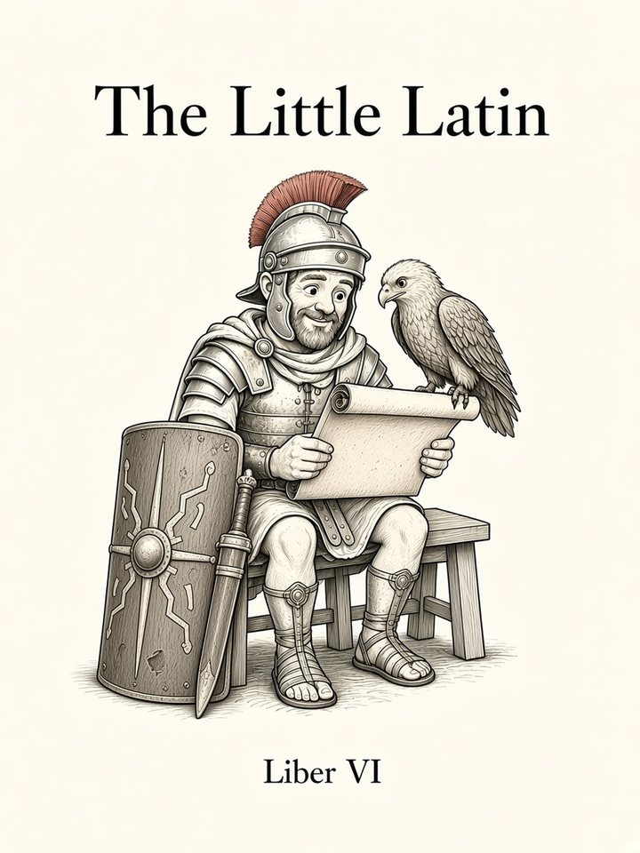

# Liber VI: Ad Auctōrēs

<figure class="book-cover" markdown="1">
{ width="360" height="480" }
</figure>

*To the Authors: Gerunds, ōrātiō oblīqua, poetry, real texts*

!!! tip "In progress"
    Chapters are arriving one by one. Below is the planned sequence, which may change as the course grows.

Chapter numbers continue across books. **G** = grammar · **V** = vocabulary · **S** = speaking goal.

| # | Chapter | Contents | Status |
|---|---|---|---|
| 61 | [**Ars Legendī**](01-ars-legendi.md) | G: gerund. | ✅ available |
| 62 | [**Carthāgō Dēlenda Est**](02-carthago-delenda-est.md) | G: gerundive; passive periphrastic + dative of agent; ad + gerundive purpose. | ✅ available |
| 63 | [**Mīrābile Dictū**](03-mirabile-dictu.md) | G: supine -um/-ū. | ✅ available |
| 64 | [**Ōrātiō Oblīqua**](04-oratio-obliqua.md) | G: subordinate clauses in indirect discourse; virtual ōrātiō oblīqua. | ✅ available |
| 65 | [**Ōrdō Verbōrum**](05-ordo-verborum.md) | G: word order, emphasis, hyperbaton, chiasmus; reading left-to-right. | ✅ available |
| 66 | **Quantitās** | G: syllable quantity rules; accent recap. | coming |
| 67 | **Arma Virumque** | G: dactylic hexameter scansion; elision. | coming |
| 68 | **Odī et Amō** | G: elegiac couplet; hendecasyllable; Catullus. | coming |
| 69 | **Caesar** | Reading: De Bello Gallico excerpts with frames. | coming |
| 70 | **Phaedrus et Mārtiālis** | Reading: fables & epigrams. | coming |
| 71 | **Cicerō et Ovidius** | Reading: letters, Metamorphoses excerpts. | coming |
| 72 | **Vergilius** | Reading: Aeneid I opening; course capstone. | coming |
